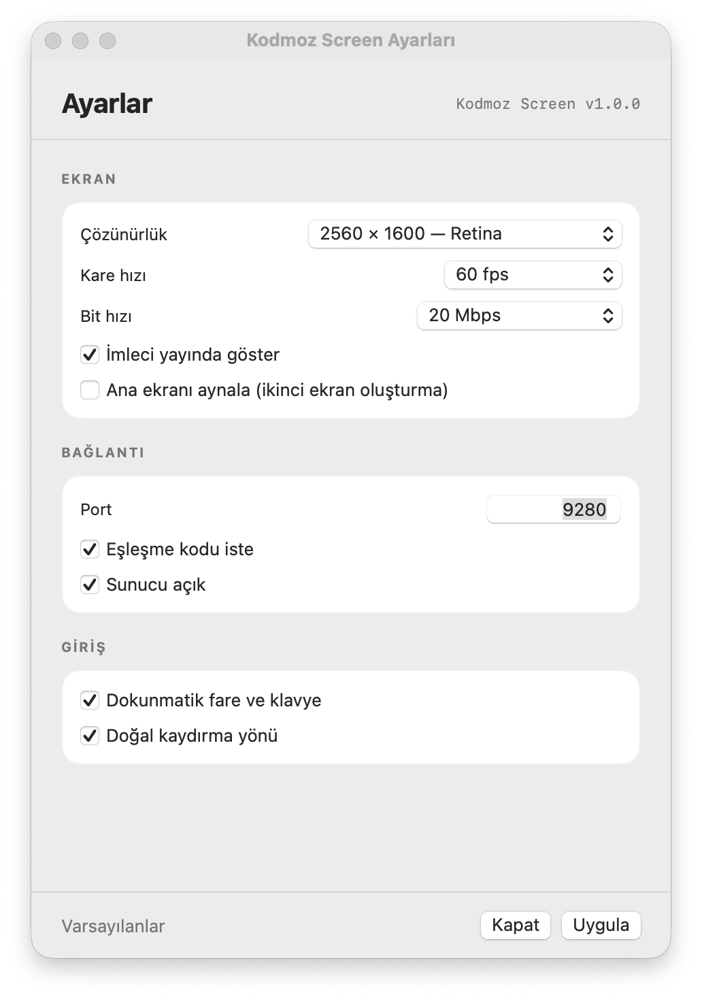
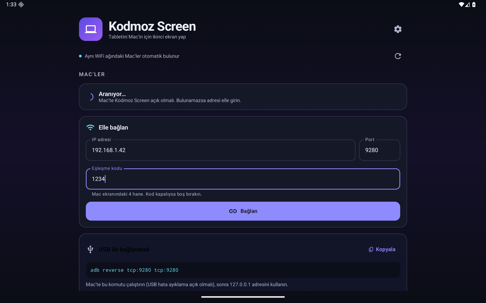
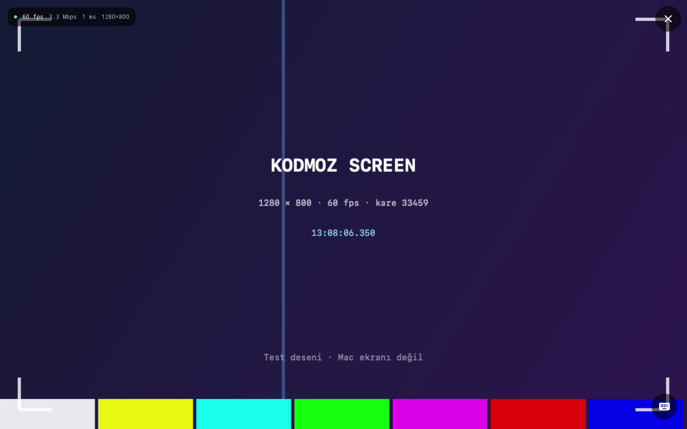

# Kodmoz Screen

[](https://github.com/hasanislamoglu5361/kodmoz-screen/actions/workflows/ci.yml)

**Android tabletinizi Mac'iniz için gerçek bir ikinci ekran yapın.**

Kodmoz Screen, macOS'ta sanal bir ekran oluşturur ve bu ekranı WiFi ya da USB
üzerinden Samsung/Android tabletinize düşük gecikmeyle aktarır. Tablet, macOS
tarafından ayrı bir monitör olarak görünür; pencereleri ona taşıyabilir,
dokunmatikle fareyi kullanabilir ve tabletin klavyesiyle Mac'e yazabilirsiniz.

<p align="center">
  
  
</p>

## Özellikler

- **Gerçek ikinci ekran** — `CGVirtualDisplay` ile sanal monitör; macOS onu
  Sistem Ayarları > Ekranlar listesinde gösterir. Varsayılan 2560 × 1600
  (1280 × 800 nokta @2×, Retina).
- **Donanım hızlandırmalı H.264** — VideoToolbox, gerçek zamanlı, B karesiz.
- **İki yakalama yolu** — ScreenCaptureKit; sanal ekranda kare gelmezse
  otomatik olarak CGDisplayStream'e düşer.
- **WiFi'de otomatik keşif** — Bonjour/mDNS (`_kodmoz-screen._tcp`).
- **USB desteği** — `adb reverse` ile kablo üzerinden, WiFi'ye gerek yok.
- **Dokunmatik fare** — tek dokunuş tıklama, uzun basıp sürükleme, iki parmak
  kaydırma, çift dokunuş.
- **Uzaktan klavye** — tabletin yumuşak klavyesi ve panodan metin gönderme.
- **4 haneli eşleşme kodu** — aynı ağdaki başka cihazların izinsiz bağlanmasını
  engeller.
- **Menü çubuğu uygulaması** — Dock'u meşgul etmez; çözünürlük, kare hızı,
  bit hızı ve giriş ayarları menüden değiştirilebilir.
- **Türkçe arayüz**, koyu tema, tek istemci.

<p align="center">
  
</p>

## Gereksinimler

| Taraf | Gereksinim |
|---|---|
| Mac | macOS 13 (Ventura) veya üzeri, Apple Silicon veya Intel |
| Tablet | Android 8.0 (API 26) veya üzeri — Samsung Tab S serisi önerilir |
| Ağ | Aynı WiFi ağı **veya** USB hata ayıklama (`adb`) |

Ekran Kaydı izni (Mac) ve dokunmatik kontrol için Erişilebilirlik izni
gereklidir. İzinler Sistem Ayarları > Gizlilik ve Güvenlik altındadır.

## Kurulum

### Mac

1. Sürümler sayfasından `KodmozScreen-macos.zip` dosyasını indirin.
2. Zip'i açın, `Kodmoz Screen.app` dosyasını **Applications** klasörüne taşıyın.
3. Uygulama noterlenmemiş bir geliştirici imzası taşıdığı için ilk açılışta
   Gatekeeper uyarabilir. Terminalde bir kez:

   ```bash
   xattr -dr com.apple.quarantine "/Applications/Kodmoz Screen.app"
   open "/Applications/Kodmoz Screen.app"
   ```

4. İlk açılışta **Ekran Kaydı** iznini verin ve uygulamayı yeniden başlatın.
   Dokunmatik kontrol için **Erişilebilirlik** iznini de verin.

### Android

1. Sürümler sayfasından `KodmozScreen-android-debug.apk` dosyasını indirin.
   (Debug anahtarıyla imzalanmıştır; kişisel kullanım içindir.)
2. Tablette "Bilinmeyen kaynaklara izin ver" seçeneğini açıp APK'yı kurun.
3. Alternatif olarak kaynaktan derleyin:

   ```bash
   cd android
   JAVA_HOME="/Applications/Android Studio.app/Contents/jbr/Contents/Home" \
     ./gradlew :app:assembleDebug
   adb install -r app/build/outputs/apk/debug/app-debug.apk
   ```

## Kullanım

### WiFi

1. Mac'te Kodmoz Screen'i açın. Menü çubuğunda ekran simgesi görünür.
2. "Bağlantı Ekranı" penceresindeki **ağ adresi** ve **eşleşme kodu**nı not edin.
3. Tablette Kodmoz Screen'i açın. Mac, **MAC'LER** listesinde otomatik görünür.
   Görünmezse adresi ve kodu elle girin.
4. Bağlandıktan sonra macOS'ta **Sistem Ayarları > Ekranlar** bölümünde yeni
   ekranı istediğiniz konuma sürükleyin. "Ana ekran" olarak ayarlamayın.

### USB (WiFi olmadan)

Mac'te Android platform-tools kurulu olmalıdır. Tablette USB hata ayıklamayı
açın, kabloyu bağlayın ve Mac'te şunu çalıştırın:

```bash
adb reverse tcp:9280 tcp:9280
```

Tablette **Elle bağlan** bölümüne `127.0.0.1`, port `9280` ve eşleşme kodunu
girin. USB kablosu hem veri hem şarj sağlar.

### Dokunmatik hareketler

| Hareket | Mac karşılığı |
|---|---|
| Tek dokunuş | Sol tık |
| Çift dokunuş | Çift tık |
| Uzun basıp sürükleme | Sol tuş basılı sürükleme |
| Tek parmak sürükleme | Fare imlecini taşıma |
| İki parmak sürükleme | Kaydırma |

Klavye düğmesi tabletin yumuşak klavyesini açar; yazdıklarınız Mac'teki etkin
pencereye gider. "Panodan gönder" tablet panosundaki metni Mac'e yazar.

## Ayarlar

Menü çubuğu menüsünden veya **Ayarlar** penceresinden:

- **Çözünürlük** — 2560×1600 (Retina), 1920×1200, 2960×1848 (Tab S9 Ultra),
  1920×1080 ve 1× seçenekleri. Retina seçenekleri gerçek 2× framebuffer kullanır.
- **Kare hızı** — 30 / 60 fps.
- **Bit hızı** — Otomatik veya 8–40 Mbps.
- **İmleç** — yayında göster/gizle.
- **Doğal kaydırma** — iki parmak yönünü çevir.
- **Eşleşme kodu** — iste/kapat, yenile.
- **Ana ekranı aynala** — sanal ekran oluşturmadan ana ekranı yayınlar (yedek mod).

## Nasıl çalışır?

```
┌──────────── Mac ────────────┐        TCP / Bonjour        ┌──── Android ────┐
│ CGVirtualDisplay (2×)       │  ───────────────────────▶   │ MediaCodec      │
│   ↓ ScreenCaptureKit        │   H.264 Annex-B + SPS/PPS   │   ↓             │
│ VideoToolbox (donanım)      │                             │ TextureView     │
│   ↓                         │   ◀───────────────────────  │                 │
│ StreamServer (NWListener)   │   dokunmatik / klavye       │ Compose UI      │
│   ↓ CGEvent                 │                             │ NSD keşif       │
└─────────────────────────────┘                             └─────────────────┘
```

- macOS 26'da `CGVirtualDisplaySettings.hiDPI` bayrağı yok sayılıyor. Uygulama,
  `kCGDisplayShowDuplicateLowResolutionModes` ile gizli 2× modlarını bulup
  `CGConfigureDisplayWithDisplayMode` ile seçiyor; böylece gerçek Retina
  framebuffer elde ediliyor.
- ScreenCaptureKit yalnızca içerik değiştiğinde kare üretir. Masaüstü
  hareketsizken 1–2 fps görmek normaldir; pencere/İmleç hareket ettiğinde
  60 fps'e çıkar.
- TCP geri baskısı 6 MB'ı aşarsa ara kareler atlanır; anahtar kareler her
  2 saniyede bir gönderilir.
- Tel formatı ve el sıkışma: [docs/PROTOCOL.md](docs/PROTOCOL.md).

## Geliştirme

```
mac/            SwiftPM menü çubuğu uygulaması (Swift 5.9+, macOS 13+)
android/        Kotlin + Jetpack Compose (AGP 9, minSdk 26)
scripts/        build.sh (ikon + .app + imza), install.sh
docs/           protokol ve ekran görüntüleri
```

Mac:

```bash
cd mac && swift build
cd .. && ./scripts/build.sh          # build/Kodmoz Screen.app
./scripts/install.sh                 # /Applications + başlat
```

Android:

```bash
cd android
JAVA_HOME="/Applications/Android Studio.app/Contents/jbr/Contents/Home" \
  ./gradlew :app:assembleDebug
```

Emülatörde test için (yalnız debug): uygulama `host`, `port`, `code` intent
ekstra'larıyla otomatik bağlanır:

```bash
adb shell am start -n com.kodmoz.screen/.MainActivity \
  --es host 10.0.2.2 --ei port 9280 --es code 1234
```

Mac'te izinler olmadan uçtan uca test:

```bash
build/Kodmoz\ Screen.app/Contents/MacOS/KodmozScreen --test-pattern
```

`--diagnose` sanal ekranın modlarını ve çözünürlüğünü yazdırır.

## Sorun giderme

| Belirti | Çözüm |
|---|---|
| "Ekran Kaydı izni gerekli" | Sistem Ayarları > Gizlilik ve Güvenlik > Ekran Kaydı'nda Kodmoz Screen'i açın, uygulamayı yeniden başlatın. |
| Tablet bağlanıyor ama görüntü yok | Mac'te sunucunun açık olduğunu ve portun (varsayılan 9280) başka uygulamada olmadığını kontrol edin. |
| Dokunmatik çalışmıyor | Erişilebilirlik iznini verin; uygulamayı yeniden başlatın. |
| Mac listede görünmüyor | Aynı WiFi'de olduğunuzdan emin olun; yerel ağ iznini verin; IP'yi elle girin. |
| Siyah ekran | "Ana ekranı aynala" seçeneğini deneyin; ekran kaydı iznini kontrol edin. |
| Düşük fps | Masaüstü hareketsizken beklenir; bit hızını artırın veya 30 fps seçin. |
| Port kullanımda | Ayarlar'dan başka bir port seçin ve `adb reverse` komutunu güncelleyin. |
| Gatekeeper uyarısı | `xattr -dr com.apple.quarantine "/Applications/Kodmoz Screen.app"` |

## Güvenlik

- Bağlantı 4 haneli eşleşme koduyla korunur; sunucu aynı anda tek istemci kabul eder.
- Trafik yerel ağda **şifrelenmemiştir** (TLS yok). Güvenmediğiniz ağlarda kullanmayın.
- Uygulama yalnızca ekran görüntüsü ve giriş olayları gönderir; ses kaydı yapmaz.
- macOS'un `CGVirtualDisplay` API'si belgelenmemiştir; gelecekteki macOS
  sürümlerinde davranışı değişebilir. Bu durumda aynalama modu devrededir.

## Lisans

MIT — Hasan İslamoğlu. Ayrıntılar için [LICENSE](LICENSE).

---

## English summary

Kodmoz Screen turns an Android tablet into a **real extended display** for
macOS. It creates a virtual monitor with `CGVirtualDisplay`, captures it with
ScreenCaptureKit (CGDisplayStream fallback), encodes H.264 with VideoToolbox,
and streams it over TCP to a native Kotlin/Compose app that decodes with
MediaCodec into a TextureView. Touch and keyboard input are injected into
macOS; a 4-digit pairing code protects the connection.

- **Requirements:** macOS 13+, Android 8+, same WiFi or USB debugging.
- **Install:** unzip the macOS app into `/Applications` and disable quarantine
  (`xattr -dr com.apple.quarantine "/Applications/Kodmoz Screen.app"`); install
  the Android APK and allow unknown sources.
- **Permissions:** Screen Recording (video) and Accessibility (touch).
- **USB:** run `adb reverse tcp:9280 tcp:9280`, connect to `127.0.0.1`.
- **Build:** see the Turkish section above; the wire protocol is documented in
  [docs/PROTOCOL.md](docs/PROTOCOL.md).
- **Limitations:** video only (no audio), unencrypted local TCP, debug-signed
  Android APK, relies on a private macOS API.
